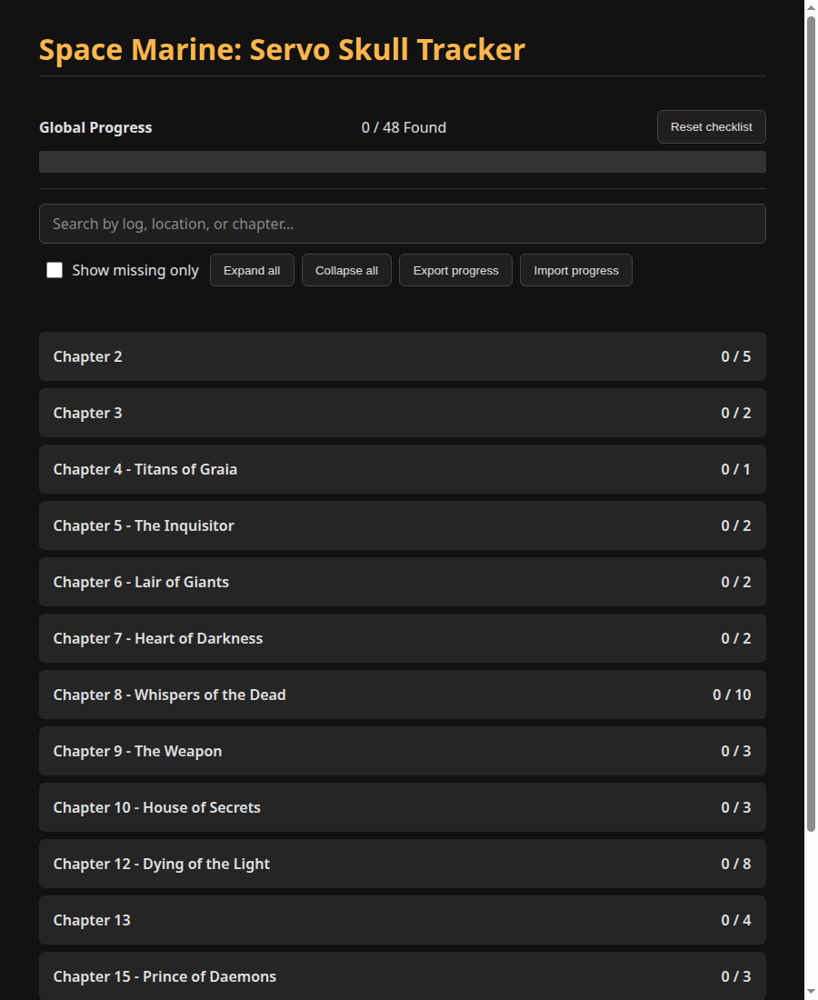

# Space Marine: Servo Skull Tracker

[](https://github.com/enonymous1/ss-space_marine_master_crafted/actions/workflows/ci.yml)
[](LICENSE)

**48 Servo Skulls. One checklist. No account, no build step, no lost progress.**

A lightweight tracker for the Servo Skull collectibles in *Warhammer 40,000: Space Marine* (2011), broken down by chapter with each skull's audio-log name and location. Check them off as you play — your progress saves in the browser and the app works offline once loaded.

**Live:** https://enonymous1.github.io/ss-space_marine_master_crafted/



## Features

- **Persistent tracking:** progress saves automatically to `localStorage`. Close the tab, come back later, your checkmarks are still there.
- **Search:** filter by audio-log name, location, chapter, or skull number (try `#23`).
- **Show missing only:** hide everything you've already found and focus on what's left.
- **Expand / collapse all:** open or close every chapter at once.
- **Export / import:** back up progress as JSON (`servo-skull-progress.json`) and move it to another device. Import validates every id and rejects unknown ones instead of silently inflating your total.
- **Offline PWA:** a service worker caches the app shell, so it works without a connection after the first load. Installable, with 192/512 PNG and maskable icons.
- **Global + per-chapter progress:** a sticky progress bar up top, and a found/total count on every chapter.

## Quick start

No build, no dependencies. Serve the directory (required for the service worker and install prompt; plain `file://` opening works for the checklist itself, but the service worker won't register):

```bash
python -m http.server 8000
```

Then open http://localhost:8000 — or just open the live Pages link above.

## How progress is stored

Progress is saved under the `servoSkullTrackerState` key as a list of stable skull ids (`{ "version": 2, "found": [1, 7, 23] }`).

That stability is deliberate: the original version keyed saves by chapter/item *position*, so reordering data could shift checkmarks onto the wrong skulls. This version migrates old position-based saves to ids on first load, drops any stale or unknown ids, and never counts them toward the total.

## Layout

```
index.html            Page shell and controls (no inline CSS/JS/data)
styles.css            Dark theme
data.js               The 48 skulls, by chapter (ids 1–48, sequential)
state.js              Pure state logic: migration, validation, export/import
app.js                Rendering, search, filters, persistence
service-worker.js     Offline cache (v2, takes over immediately, never caches itself)
manifest.webmanifest  PWA manifest (192/512 + maskable icons)
icon-*.png            PWA icons (icon.svg kept as the favicon)
tests/                Node tests (built-in runner, zero dependencies)
```

## Tests

```bash
node --test tests/tracker.test.js
```

9 tests cover the data (48 sequential unique ids, non-empty fields), state migration (legacy position keys → ids, stale-id rejection, corrupt input), export/import validation, search matching, the app shell (split files, all controls present, no `innerHTML`), the manifest (icons exist, theme matches the page), and the service worker (cache list matches files on disk, worker excluded from its own cache). CI runs the same command plus a syntax check on every script.

## Non-goals

- No framework, bundler, or backend — this stays a static site you can host anywhere.
- No account, analytics, or server-side storage. Export is the backup story.
- No screenshots or video of skull locations (yet) — the location text is the guide.
- Not a guide to the rest of the game: chapters with no Servo Skulls (1, 11, 14) simply have no section. If you find a skull missing from the list, that's a data bug — please open an issue with its chapter and location.

## Reflection

This started as an exercise in what vanilla HTML, CSS, and JavaScript can do without a framework — and that answer held up. The modernization kept the zero-dependency core and spent its effort where it actually helps a player: data you can edit without touching the UI, save keys that survive a data edit, a PWA that updates instead of going stale, and the search/export features the original README listed as future work.

## Disclaimer

Unofficial fan project. Not affiliated with, endorsed by, or connected to Games Workshop. *Warhammer 40,000: Space Marine* and Servo Skulls are trademarks of their respective owners.

## License

MIT — see [LICENSE](LICENSE).
